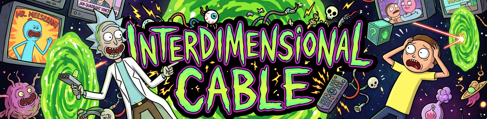
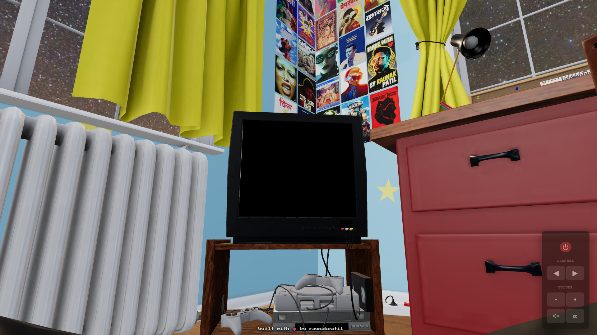
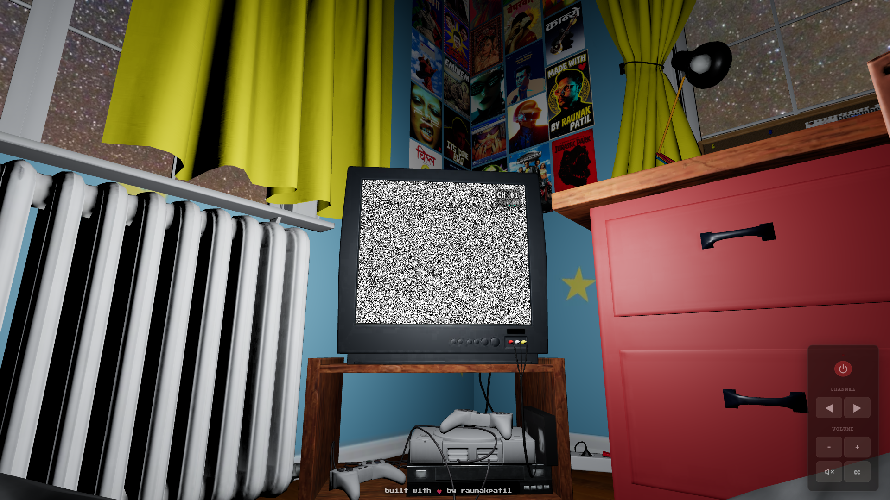
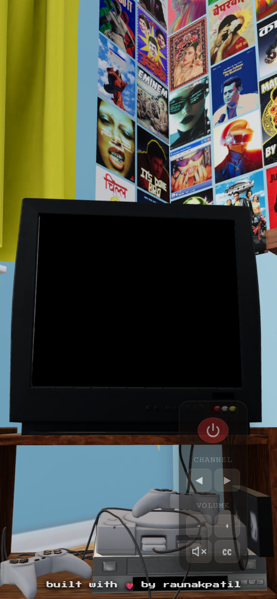
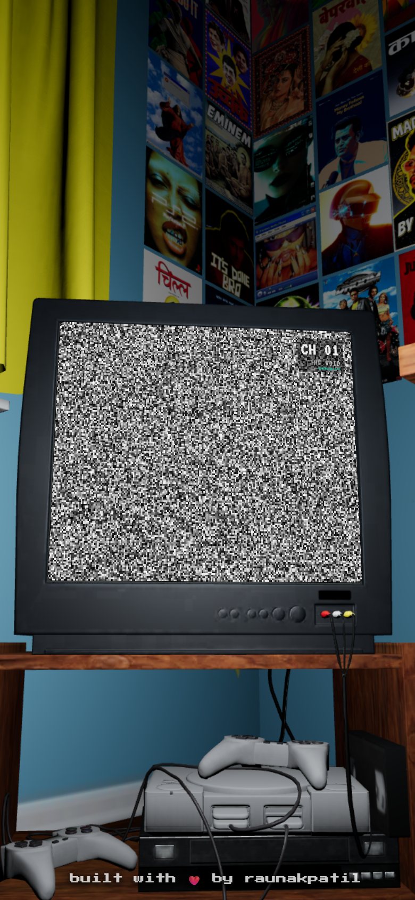

# 📺 Interdimensional Cable



> An immersive, nostalgic analog TV simulator for surfing a chaotic, totally randomized abyss of YouTube videos.

[](https://raunakpatil.github.io/InterdimentionalCable/)
[](https://developer.mozilla.org)
[](https://developer.mozilla.org)
[](https://developers.google.com/youtube/iframe_api_reference)

---

> **Inspired by the legendary *Rick and Morty* episode, this project completely rejects algorithms and curation.**
> Instead of a predictable grid of thumbnails, it throws you into a randomized multiverse of weird, obscure, and chaotic YouTube broadcasts. It asks the question: *what if you were sitting on the floor in an alternate dimension, endlessly flipping through unpredictable analog channels on a glowing CRT television?*

---

## 📸 Demo

<div align="center">
  <h3><a href="https://raunakpatil.github.io/InterdimentionalCable/">◀️ Click Here to Watch Interdimentional Tv Live ▶️</a></h3>
</div>

### 📻 Ambient Power-Off State


### 📺 Immersive CRT Experience


### 📲 Mobile Native Experience (Power Off & On)
<p align="center">
  
  
</p>

---

## ✨ Features

| Feature | What it does |
|---------|--------------|
| 📺 **Authentic CRT Simulation** | Curved glass, phosphor bloom, scanlines, and RGB split effects built purely in CSS. |
| 📻 **Seamless Channel Surfing** | Custom YouTube API integration with pre-fetching for instant channel switching. |
| 🎬 **Cinematic Power Sequence** | Glowing boot text, static bursts, audio cues, and a creeping cinematic zoom-in effect. |
| 📱 **Mobile Optimized** | Flawless responsive layout, gesture support (swipe to change channel), and a tailored UI that fits portrait screens perfectly. |
| 🎭 **Dynamic Static Engine** | HTML5 Canvas generating randomized 60fps noise, tracking hum, and V-Sync drops, tied together with procedural Web Audio API static. |
| 🧠 **Intelligent Video Rotation** | "Offline Vault" fallback system automatically preempts YouTube end-screens, keeping the immersion completely unbroken. |
| 🛋️ **3D Room** | A real-time, first-person view from the beanbag in a 90s bedroom. The 3D room is the only viewing mode. |

---

## 🛋️ 3D Room

The site opens directly in a real 3D room: the existing CRT, YouTube player,
OSD, static and power effects are embedded into a modelled television, viewed
from a fixed seat on the beanbag. The camera stays put; moving the mouse only
looks around a little. There is no 2D/3D toggle, saved viewing preference,
`?3d=off`, or auto-2D mode on phones.

- The model is committed as `room.glb` (5.63 MiB, Meshopt + WebP).
- 30 desktop posters hang above the CRT — 25 original prints plus five new
  top-row prints. The back wall carries 14 regular prints and the featured
  **Pop Transformation**; the left corner carries 10. One new print fills the
  empty top slot above each of the five columns. The highest original print in
  each column is wrapped below that column's lowest print; every other print
  keeps its position. The old collage baked into the wall textures is painted
  out at runtime, the paper-airplane mobile is removed, and the prints load
  behind the boot screen so nothing pops in.
- Both windows look onto a 360° desert night sky that drifts slowly from left to
  right in a seamless five-minute loop (fixed under reduced motion). The glass
  has only a faint tint so it does not haze the view.
- Turning the TV on fades the room, window, image-based and ceiling lighting to
  zero. The CRT is then the only light source in the room.
- A minimal **INTERDIMENSIONAL TV** boot screen covers the hidden room while the
  model, posters and night sky download, then fades into the finished 3D room.
  Powering on during the load queues the press and turns the set on in 3D.
- Camera, lighting, model anchors and fallback behaviour are documented in
  [`docs/3d-room.md`](docs/3d-room.md).

---

## 🛠 Tech stack

| Layer | Technology |
|-------|-----------|
| Core Logic | Vanilla JavaScript (ES6+) |
| Media Player | YouTube IFrame Player API |
| Aesthetics & UI | Vanilla CSS3 (Custom Variables, Keyframe Animations, Mix-Blend-Modes) |
| 3D Room | Three.js r186, GLTFLoader, CSS3DRenderer, Meshopt |
| Visual Effects Engine | HTML5 Canvas API |
| Audio Engine | Web Audio API (Procedural Static Generation) |

---

## 🚀 Setup & Installation

Since the project is built entirely in Vanilla JS and CSS with no build steps or dependencies, getting it running is completely friction-free:

1. **Clone the repository**
   ```bash
   git clone https://github.com/raunakpatil/InterdimentionalCable.git
   ```

2. **Serve locally**
   You can run it using any simple local server (like Python's HTTP server or VS Code Live Server):
   ```bash
   cd InterdimentionalCable
   python -m http.server 8080
   ```

3. **Open in browser**
   Navigate to `http://localhost:8080` to tune in.

---

## 🔧 Architecture Overview

* **`app.js`**: Core state machine handling power sequences, gesture controls (swiping), remote control UI, and global event listeners.
* **`youtube.js`**: Manages the YouTube IFrame API lifecycle, dynamically loads the `FALLBACK_VAULT`, and continuously monitors playback to prevent YouTube's UI from breaking immersion.
* **`effects.js`**: Houses the HTML5 Canvas static noise generator and coordinates the `vhs-static-chaos` CSS animations during channel switches.
* **`three-scene.js`**: Three.js room layer. Loads `room.glb`, finds the seat/TV anchors, builds the 30-print gallery, lights the room, and embeds the existing TV DOM in a CSS3D surface. Turning the TV on makes the CRT the only light source. All camera, model and lighting options are in `DEFAULT_CONFIG`.
* **`three-scene.css`**: Layers the WebGL canvas, CSS3D TV surface, status messages and boot screen over the hidden DOM room.
* **`sounds.js`**: Synthesizes procedural white noise using the Web Audio API and manages sound effects (button clicks, TV power).
* **`style.css`**: The true heavy lifter—creating the 3D television bevel, curved CRT glass, scanlines, and all cinematic transitions natively.

---
